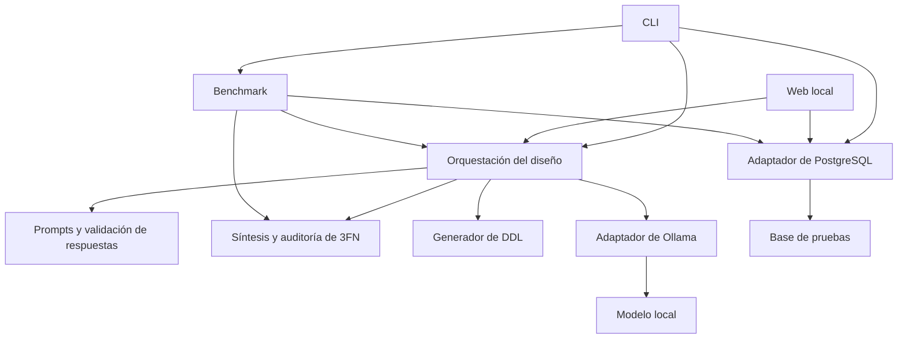

# Arquitectura del Modelador 3FN

El CLI y la interfaz web usan el mismo flujo de diseño. El benchmark ejecuta
ambos modos y evalúa sus resultados con los casos de referencia.

| Módulo | Responsabilidad |
|---|---|
| `core.py` | Operaciones sobre dependencias funcionales, síntesis y auditoría |
| `pipeline.py` | Coordinación de los modos multiagente y de un agente, reintentos y trazas |
| `agents.py` | Prompts, contratos JSON y validación de las respuestas |
| `sql.py` | Producción de DDL a partir de tablas y tipos aprobados |
| `evaluation.py` | Comparación con resultados esperados y exportación del benchmark |
| `adapters/` | Comunicación con Ollama y validación de DDL mediante `psql` |
| `cli.py` y `web.py` | Entrada por consola o navegador y presentación de resultados |

El núcleo de 3FN puede ejecutarse con datos locales. Sus comprobaciones
dependen de las dependencias funcionales proporcionadas. El benchmark usa las
dependencias de referencia para detectar omisiones del análisis. La auditoría
exacta admite hasta 14 atributos por tabla.

[ADR-001: Organización modular](adr/001-organizacion-modular.md)
